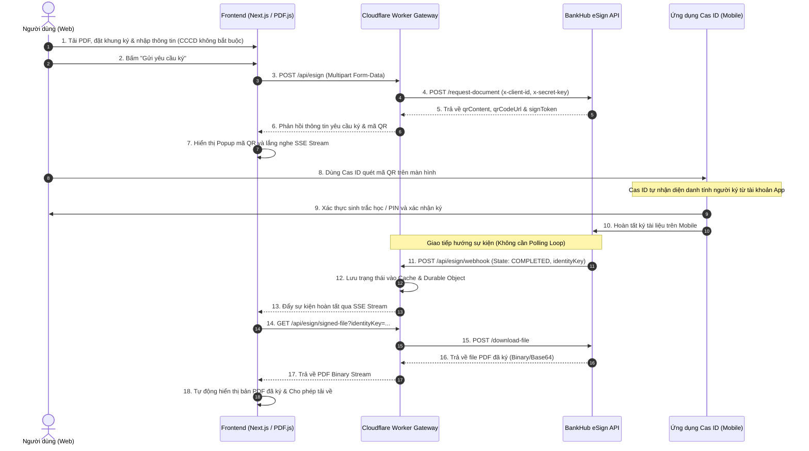

# TÀI LIỆU TỔNG HỢP HỆ THỐNG CAS SIGN: APIS, CƠ CHẾ HOẠT ĐỘNG & TRA CỨU CHỮ KÝ

---

## MỤC LỤC
1. [Giới thiệu tổng quan hệ thống](#1-giới-thiệu-tổng-quan-hệ-thống)
2. [Kiến trúc kỹ thuật & Công nghệ sử dụng](#2-kiến-trúc-kỹ-thuật--công-nghệ-sử-dụng)
3. [Tổng hợp danh sách các API](#3-tổng-hợp-danh-sách-các-api)
   - [3.1. API Gửi yêu cầu ký tài liệu (Push Sign Request)](#31-api-gửi-yêu-cầu-ký-tài-liệu-push-sign-request)
   - [3.2. API Webhook nhận thông báo kết quả ký (Webhook Callback)](#32-api-webhook-nhận-thông-báo-kết-quả-ký-webhook-callback)
   - [3.3. API Tải file PDF đã ký (Download Signed File)](#33-api-tải-file-pdf-đã-ký-download-signed-file)
   - [3.4. API Kiểm tra trạng thái yêu cầu ký theo nhu cầu (On-Demand Status Check)](#34-api-kiểm-tra-trạng-thái-yêu-cầu-ký-theo-nhu-cầu-on-demand-status-check)
   - [3.5. API Stream trạng thái thời gian thực (SSE Stream)](#35-api-stream-trạng-thái-thời-gian-thực-sse-stream)
   - [3.6. API Tra cứu thông tin chữ ký & chứng thư số (Signing Round Lookup)](#36-api-tra-cứu-thông-tin-chữ-ký--chứng-thư-số-signing-round-lookup)
4. [Cơ chế hoạt động chi tiết](#4-cơ-chế-hoạt-động-chi-tiết)
   - [4.1. Quy trình ký tài liệu điện tử (Signing Flow)](#41-quy-trình-ký-tài-liệu-điện-tử-signing-flow)
   - [4.2. Cơ chế xử lý hướng sự kiện qua Webhook (Không cần Polling Loop)](#42-cơ-chế-xử-lý-hướng-sự-kiện-qua-webhook-không-cần-polling-loop)
   - [4.3. Cơ chế Lưu trữ & Phục hồi phiên làm việc (Session Persistence)](#43-cơ-chế-lưu-trữ--phục-hồi-phiên-làm-việc-session-persistence)
   - [4.4. Cơ chế Xử lý & Chuẩn hóa tọa độ chữ ký PDF](#44-cơ-chế-xử-lý--chuẩn-hóa-tọa-độ-chữ-ký-pdf)
5. [Trang tra cứu & Kiểm tra thông tin ID chữ ký (`/lookup`)](#5-trang-tra-cứu--kiểm-tra-thông-tin-id-chữ-ký-lookup)
   - [5.1. Mục đích & Vai trò](#51-mục-đích--vai-trò)
   - [5.2. Định dạng mã tra cứu `orgIdSigned`](#52-định-dạng-mã-tra-cứu-orgidsigned)
   - [5.3. Cấu trúc dữ liệu chi tiết trả về](#53-cấu-trúc-dữ-liệu-chi-tiết-trả-về)
   - [5.4. Giao diện trực quan hóa thông tin chứng thư số](#54-giao-diện-trực-quan-hóa-thông-tin-chứng-thư-số)
6. [Cấu hình môi trường & Triển khai](#6-cấu-hình-môi-trường--triển-khai)

---

## 1. Giới thiệu tổng quan hệ thống

**CAS Sign** là giải pháp ký số và xác thực tài liệu điện tử từ xa (Remote Signing) tích hợp với nền tảng **BankHub eSign** và ứng dụng di động **Cas ID**.

Hệ thống cung cấp trải nghiệm ký số hiện đại, an toàn và tối giản:
- **Trực quan hóa vùng ký**: Cho phép tải lên tài liệu PDF, kéo thả, co giãn và chỉ định nhiều khung ký trên từng trang tài liệu.
- **Tạo yêu cầu ký linh hoạt**: **Không bắt buộc nhập số CCCD/CMND** (người ký sẽ được định danh trực tiếp qua tài khoản ứng dụng Cas ID khi quét mã). Hỗ trợ nhập Mã số thuế khi thực hiện ký doanh nghiệp.
- **Sinh mã QR Code động**: Trả về dữ liệu QR (`qrContent`, `qrCodeUrl`, `signToken`) ngay sau khi tạo yêu cầu, giúp người dùng quét và ký số tức thì trên ứng dụng di động Cas ID.
- **Kiến trúc hướng sự kiện qua Webhook**: Kết quả ký được BankHub đẩy trực tiếp về hệ thống qua Webhook callback (và đồng bộ qua Server-Sent Events). **Loại bỏ hoàn toàn cơ chế Polling lặp lại** gây lãng phí băng thông và tài nguyên máy chủ.
- **Trực quan hóa & Tải file đã ký**: Tự động giải mã file PDF ký số tiêu chuẩn và cập nhật trực tiếp trên trình duyệt.
- **Thẩm định & Tra cứu chữ ký (`/lookup`)**: Hỗ trợ tra cứu vòng ký (`orgIdSigned`), kiểm tra tính pháp lý, tính toàn vẹn của tệp, thông tin chứng thư số (CA) và thiết bị ký.

---

## 2. Kiến trúc kỹ thuật & Công nghệ sử dụng

```
┌─────────────────────────────────────────────────────────────────────────────┐
│                            CLIENT (TRÌNH DUYỆT)                              │
│  - Next.js App Router (React 19, TypeScript, Lucide Icons)                  │
│  - Render & Preview PDF: PDF.js (pdfjs-dist)                                │
│  - Quản lý phiên làm việc: IndexedDB (CasSignDB / current_session)          │
│  - Nhận sự kiện Realtime: EventSource (Server-Sent Events)                  │
└───────────────────────┬─────────────────────────────────────────────────────┘
                        │ HTTP POST (Tạo yêu cầu) / SSE Stream (Nhận kết quả)
                        ▼
┌─────────────────────────────────────────────────────────────────────────────┐
│                   CLOUDFLARE WORKER GATEWAY & PROXY                         │
│  - Entrypoint: worker/index.ts (Vinext Server Runtime)                      │
│  - Bảo mật Credentials: x-client-id, x-secret-key được bảo vệ phía Server    │
│  - Xử lý Webhook Callback: Xác thực token & lưu cache tức thì               │
│  - State Storage: Cloudflare Cache API & Durable Object (SIGN_STATUS)       │
│  - Bộ giải mã PDF: Tự động trích xuất Base64 hoặc luồng Binary Stream       │
└───────────────┬─────────────────────────────────────────────▲───────────────┘
                │ 1. Forward Request                          │ 3. Webhook Push
                ▼                                             │    (Event-driven)
┌─────────────────────────────────────────────────────────────┴───────────────┐
│                  HỆ THỐNG NGOÀI (BANKHUB & CAS ID)                          │
│  - BankHub eSign API Gateway: Cấp QR, điều phối ký số                       │
│  - Ứng dụng di động Cas ID: Quét QR, xác thực sinh trắc học / SmartCA       │
│  - CMC Telecom Cloud S3: Lưu trữ an toàn file PDF đã ký                     │
└─────────────────────────────────────────────────────────────────────────────┘
```

---

## 3. Tổng hợp danh sách các API

### 3.1. API Gửi yêu cầu ký tài liệu (Push Sign Request)

- **Đường dẫn**: `POST /api/esign`
- **Mô tả**: Tiếp nhận file PDF, thông tin người ký và danh sách tọa độ các khung ký từ client. Worker đính kèm thông tin xác thực (`x-client-id`, `x-secret-key`) và forward lên BankHub upstream (`https://production.bankhub.dev/esign/request-document`). Trả về thông tin mã QR động để người dùng quét ký ngay lập tức.
- **Định dạng dữ liệu**: `multipart/form-data`

#### Danh sách tham số Form-Data:
| Tên trường | Kiểu dữ liệu | Bắt buộc | Mô tả |
| :--- | :--- | :---: | :--- |
| `signRequestId` | `string` | **Có** | Mã định danh yêu cầu ký dạng `CAS-<TIMESTAMP>-<RANDOM>` (Ví dụ: `CAS-M4Z1K8-9A8B7C6D`). |
| `file` | `File (Binary)` | **Có** | File tài liệu PDF cần ký, dung lượng tối đa 20 MB. |
| `documentName` | `string` | **Có** | Tên tài liệu cần ký (độ dài 10 - 200 ký tự). |
| `organizationName` | `string` | **Có** | Tên đơn vị gửi yêu cầu ký (Mặc định: `"Cas Sign"`). |
| `identificationNumber`| `string` | **Không** | Số CCCD/CMND của người ký (**Tùy chọn**, người ký tự định danh qua ứng dụng Cas ID khi quét QR). |
| `taxCode` | `string` | Điều kiện | Mã số thuế doanh nghiệp (Bắt buộc nếu bật chế độ Ký doanh nghiệp, gồm 10 số hoặc 10 số-3 số). |
| `signatureFields` | `string (JSON)` | **Có** | Mảng JSON chứa tọa độ tỷ lệ chuẩn hóa của các vùng ký. |

#### Phản hồi mẫu thành công có kèm dữ liệu QR (HTTP 200):
```json
{
  "requestId": "CAS-M4Z1K8-9A8B7C6D",
  "pushSignRequestDocument": {
    "signRequestId": "CAS-M4Z1K8-9A8B7C6D",
    "qrContent": "https://id.cas.vn/sign?token=eyJhbGciOiJIUzI1NiIsInR5cCI6IkpXVCJ9...",
    "qrCodeUrl": "https://id.cas.vn/sign?token=eyJhbGciOiJIUzI1NiIsInR5cCI6IkpXVCJ9...",
    "signToken": "948201",
    "expiresIn": 900,
    "state": "PENDING"
  }
}
```

---

### 3.2. API Webhook nhận thông báo kết quả ký (Webhook Callback)

- **Đường dẫn**: `/api/esign/webhook`
- **Phương thức hỗ trợ**: `POST` (Nhận sự kiện từ BankHub), `GET` (Kiểm tra trạng thái URL), `HEAD`, `OPTIONS`.
- **Cơ chế xác thực**:
  - So khớp `token` với biến môi trường `ESIGN_WEBHOOK_SECRET`.
  - Hỗ trợ truyền qua Query Param: `?token=<SECRET>` hoặc Header: `x-webhook-token`, `Authorization: Bearer <SECRET>`.
- **URL đăng ký với đối tác BankHub**:
  ```text
  https://cas-sign.<domain-cua-ban>.workers.dev/api/esign/webhook?token=<ESIGN_WEBHOOK_SECRET>
  ```
- **Xử lý phía Worker**: Ngay khi BankHub gửi thông báo `COMPLETED` kèm `identityKey`, Worker lưu ngay trạng thái vào **Durable Object / Cache API** và kích hoạt push realtime qua luồng SSE.

#### Payload mẫu từ BankHub gửi về khi ký hoàn tất (POST):
```json
{
  "signRequest": {
    "signRequestId": "CAS-M4Z1K8-9A8B7C6D",
    "state": "COMPLETED",
    "identityKey": "id_key_signed_998124_pdf",
    "signedFileUrl": "https://s3.hn-2.cloud.cmctelecom.vn/cas-bucket/signed_doc.pdf",
    "rejectedReason": null,
    "expiresIn": 604800
  }
}
```

---

### 3.3. API Tải file PDF đã ký (Download Signed File)

- **Đường dẫn**: `GET /api/esign/signed-file` hoặc `POST /api/esign/signed-file`
- **Tham số**:
  - `identityKey` *(Ưu tiên)*: Mã định danh file đã ký do BankHub cấp.
  - `url` *(Fallback)*: Đường dẫn S3 trực tiếp.
- **Xử lý**:
  - Worker kiểm tra bộ nhớ đệm Cache API theo key `identityKey`.
  - Nếu chưa có, gọi upstream `POST ${apiBase}/download-file`.
  - Hỗ trợ giải mã linh hoạt: Tự động trích xuất chuỗi Base64 hoặc nhận luồng nhị phân trực tiếp (`application/pdf`), lưu cache 24h và trả về `Content-Type: application/pdf`.

---

### 3.4. API Kiểm tra trạng thái yêu cầu ký theo nhu cầu (On-Demand Status Check)

- **Đường dẫn**: `GET /api/esign/status/:signRequestId`
- **Mục đích**: Dùng làm cơ chế **tra cứu tức thời (On-demand/Manual Refresh)** khi người dùng bấm nút làm mới thủ công hoặc kiểm tra trạng thái ban đầu, **không dùng cho polling lặp lại**.
- **Cơ chế**:
  - Ưu tiên đọc từ Durable Object / Cache API (nếu Webhook đã cập nhật, trả về ngay lập tức với `requestId: "webhook-state"`).
  - Nếu chưa có, gọi BankHub `POST /request-status` để lấy dữ liệu mới nhất.

---

### 3.5. API Stream trạng thái thời gian thực (SSE Stream)

- **Đường dẫn**: `GET /api/esign/stream/:signRequestId`
- **Mô tả**: Thiết lập kết nối Server-Sent Events (SSE) giữa trình duyệt và Cloudflare Durable Object (`SignStatusStore`). Khi Webhook nhận kết quả từ BankHub, Worker đẩy ngay dữ liệu tới trình duyệt mà Client không cần gửi thêm bất kỳ request nào.

---

### 3.6. API Tra cứu thông tin chữ ký & chứng thư số (Signing Round Lookup)

- **Đường dẫn**: `GET /api/esign/signing-round` hoặc `GET /api/esign/signing-round/:orgIdSigned`
- **Tham số Query**:
  - `orgIdSigned` *(Bắt buộc)*: Mã định danh vòng ký (ví dụ: `kysoqr.com#vpl2z_`).
  - `language`: Ngôn ngữ (`vi` hoặc `en`, mặc định: `vi`).
- **Worker xử lý**: Gọi upstream `GET ${apiBase}/signing-round/${orgIdSigned}` kèm thông tin xác thực `x-client-id`, `x-secret-key`, `language`.

#### Cấu trúc phản hồi đầy đủ (HTTP 200):
```json
{
  "requestId": "REQ-LOOKUP-9921",
  "signingRound": {
    "authMethod": "Xác thực mã PIN trên Cas ID",
    "signedAt": "15:30:22 03/09/2026",
    "device": {
      "model": "iPhone 15 Pro Max (iOS 18.2)"
    },
    "signer": {
      "displayName": "NGUYỄN VĂN A"
    },
    "certificate": {
      "issuer": {
        "commonName": "VNPT-CA",
        "organization": "TẬP ĐOÀN BƯU CHÍNH VIỄN THÔNG VIỆT NAM",
        "country": "VN"
      },
      "signer": {
        "commonName": "NGUYỄN VĂN A",
        "taxOrCitizenId": "001200001234",
        "country": "VN"
      },
      "documentIntegrity": "Tài liệu không bị chỉnh sửa sau khi ký",
      "signatureValidity": "Chữ ký hợp lệ tại thời điểm ký",
      "hasTimestamp": "Có (Timestamp Token chuẩn RFC 3161)",
      "validFrom": "2025-01-01 00:00:00",
      "validTo": "2027-01-01 23:59:59",
      "signedAtLong": "2026-09-03T15:30:22.000+07:00"
    }
  }
}
```

---

## 4. Cơ chế hoạt động chi tiết

### 4.1. Quy trình ký tài liệu điện tử (Signing Flow)



---

### 4.2. Cơ chế xử lý hướng sự kiện qua Webhook (Không cần Polling Loop)

Hệ thống hoạt động theo mô hình **Event-Driven Architecture (EDA)** hiện đại thay vì dùng vòng lặp Polling truyền thống:

1. **Loại bỏ hoàn toàn Polling lặp lại**:
   - Client **không** chạy vòng lặp gửi HTTP request định kỳ (không còn cơ chế đếm ngược 30s + lặp lại mỗi 5s).
   - Giảm tải 100% request rác lên hạ tầng Cloudflare Worker và BankHub.
2. **Kích hoạt đẩy sự kiện tức thì qua Webhook & SSE**:
   - Khi người ký hoàn thành thao tác trên ứng dụng Cas ID, BankHub kích hoạt ngay Webhook `POST /api/esign/webhook` về Worker.
   - Worker cập nhật trạng thái vào Durable Object và đẩy dữ liệu trực tiếp tới Client qua Server-Sent Events (SSE).
   - Thời gian cập nhật trạng thái gần như tức thời (Realtime / Near zero-latency).
3. **Cập nhật thủ công dự phòng (Manual Fallback)**:
   - Client chỉ cung cấp nút bấm **"Cập nhật trạng thái thủ công"** khi người dùng muốn chủ động kiểm tra trạng thái nếu mất kết nối SSE đột ngột.

---

### 4.3. Cơ chế Lưu trữ & Phục hồi phiên làm việc (Session Persistence)

- Ứng dụng sử dụng **IndexedDB** (`CasSignDB`, object store: `sessionStore`, key: `current_session`) chạy ngầm trên trình duyệt.
- Tự động lưu trữ:
  - Dữ liệu biểu mẫu (Tên tài liệu, Gửi từ, Mã số thuế).
  - Toàn bộ binary của file PDF (`fileBuffer`).
  - Danh sách tọa độ các khung ký (`fields`).
  - Trạng thái phiên ký (`activeRequestId`, `qrContent`, `signToken`, `qrUrl`, `status`).
- **Lợi ích**: Khi người dùng tải lại trang (F5) hoặc mất kết nối mạng tạm thời, toàn bộ phiên làm việc, file PDF và mã QR đang chờ ký sẽ được khôi phục nguyên vẹn.

---

### 4.4. Cơ chế Xử lý & Chuẩn hóa tọa độ chữ ký PDF

Hệ tọa độ hiển thị trên Canvas web (gốc tọa độ ở góc trên-trái) khác với hệ tọa độ chuẩn của PDF (gốc tọa độ `(0,0)` ở góc dưới-trái). 

Frontend thực hiện chuẩn hóa tỷ lệ (giá trị từ `0.0` đến `1.0`) trước khi gửi lên API:

$$\text{yRatio}_{\text{PDF}} = \max\left(0, \min\left(1, 1 - \text{yRatio}_{\text{Web}} - \text{heightRatio}\right)\right)$$

Cấu trúc đối tượng chữ ký gửi đi:
```json
[
  {
    "page": 1,
    "xRatio": 0.52,
    "yRatio": 0.18,
    "widthRatio": 0.34,
    "heightRatio": 0.1,
    "fieldType": "SIGNATURE"
  }
]
```

---

## 5. Trang tra cứu & Kiểm tra thông tin ID chữ ký (`/lookup`)

Trang tra cứu được xây dựng tại đường dẫn: `https://<domain>/lookup` (hoặc truy cập qua tab **"Tra cứu chữ ký"** trên thanh điều hướng).

### 5.1. Mục đích & Vai trò
- Cho phép khách hàng, đối tác và kiểm toán viên thẩm định tính pháp lý của tài liệu đã ký qua CAS Sign.
- Xác thực chữ ký số, kiểm tra tính toàn vẹn văn bản (có bị chỉnh sửa sau khi ký hay không).
- Xem chi tiết danh tính người ký, nhà cung cấp dịch vụ chứng thực số (CA) và thiết bị thực hiện ký.

### 5.2. Định dạng mã tra cứu `orgIdSigned`
- Mã vòng ký có cấu trúc: `<tên_tổ_chức>#<id_chữ_ký>` (Ví dụ: `kysoqr.com#vpl2z_`).

### 5.3. Cấu trúc dữ liệu chi tiết trả về

```text
SigningRoundData
├── requestId (Mã yêu cầu tra cứu)
└── signingRound
    ├── authMethod (Phương thức xác thực: PIN, Biometrics, SmartCA...)
    ├── signedAt (Thời gian ký dạng chuỗi dễ đọc)
    ├── device
    │   └── model (Tên và model thiết bị di động đã ký)
    ├── signer
    │   └── displayName (Tên hiển thị của người ký)
    └── certificate
        ├── issuer (Đơn vị chứng thực chữ ký số - CA)
        │   ├── commonName (Nhà cung cấp CA: VNPT-CA, Viettel-CA...)
        │   ├── organization (Tổ chức quản lý CA)
        │   └── country (Quốc gia cấp phép)
        ├── signer (Thông tin chủ thể trên chứng thư)
        │   ├── commonName (Họ và tên đầy đủ trên chứng thư)
        │   ├── taxOrCitizenId (Số CCCD hoặc Mã số thuế)
        │   └── country (Quốc gia)
        ├── documentIntegrity (Đánh giá tính toàn vẹn văn bản)
        ├── signatureValidity (Tính hợp lệ của chữ ký)
        ├── hasTimestamp (Dấu thời gian Timestamp RFC 3161)
        ├── validFrom (Thời điểm bắt đầu hiệu lực chứng thư)
        ├── validTo (Thời điểm hết hiệu lực chứng thư)
        └── signedAtLong (Thời gian ký chuẩn ISO 8601 kèm múi giờ)
```

### 5.4. Giao diện trực quan hóa thông tin chứng thư số
1. **Banner Xác thực Tổng quan**: Huy hiệu hợp lệ, nhãn kiểm tra toàn vẹn văn bản và dấu thời gian Timestamp RFC 3161.
2. **Khối Thông tin Người ký**: Tên người ký, số định danh, phương thức xác thực và thiết bị ký.
3. **Khối Chứng thư số & Nhà cấp CA**: Tên nhà cung cấp CA, tổ chức chứng thực, thời hạn hiệu lực.
4. **Khối Trình xem JSON Gốc**: Hỗ trợ xem cấu trúc JSON kỹ thuật và tích hợp nút sao chép nhanh cho lập trình viên.

---

## 6. Cấu hình môi trường & Triển khai

### 6.1. Danh sách biến môi trường (Environment Variables)

| Tên biến | Bắt buộc | Môi trường áp dụng | Ý nghĩa |
| :--- | :---: | :--- | :--- |
| `ESIGN_CLIENT_ID` | **Có** | Worker Secret / `.env` | Client ID được BankHub cấp cho ứng dụng. |
| `ESIGN_SECRET_KEY` | **Có** | Worker Secret / `.env` | Secret Key dùng để xác thực các cuộc gọi API. |
| `ESIGN_API_URL` | Không | Worker Secret / `.env` | Endpoint API BankHub (Mặc định: `https://production.bankhub.dev/esign/request-document`). |
| `ESIGN_WEBHOOK_SECRET`| **Có** | Worker Secret / `.env` | Chuỗi bí mật dùng để xác thực Webhook callback. |
| `CLOUDFLARE_API_TOKEN`| **Có** | GitHub Actions Secret | Token cấp quyền triển khai Cloudflare Workers. |
| `CLOUDFLARE_ACCOUNT_ID`| **Có** | GitHub Actions Secret | Account ID của tài khoản Cloudflare. |

### 6.2. Triển khai tự động qua GitHub Actions
Khi có commit đẩy lên nhánh `main`, quy trình `.github/workflows/deploy.yml` sẽ tự động:
1. Cài đặt dependencies và build dự án với `vinext`.
2. Deploy mã nguồn lên Cloudflare Worker (`cas-sign`).
3. Tự động đồng bộ các biến secrets được mã hóa lên Cloudflare Worker qua lệnh `wrangler secret bulk`.
